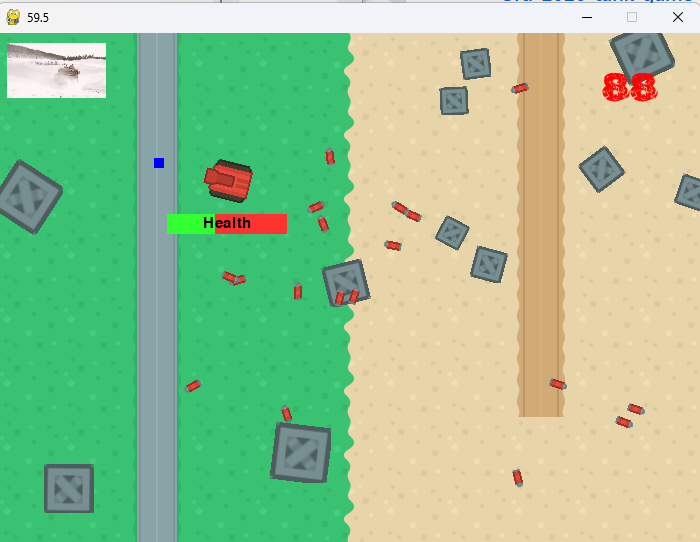

## Tanky Shooty Game
### Coded by LCDR Allan Elsberry
---
Drive your tank around and shoot at things! Try to stay alive to get more points! Dont run into the dreaded crates of death.

**Screenshot**


**How to Play**
1. Install the game and `python`
2. Run `game.py` with some version python 3
3. Drive your tank with the arrow keys
4. Shoot with the `spacebar` key

**This is some code that I like:**
```python
for i in range(10):
  print(i)
```


*The features that I get points for:*
1. Looking weak / health bar  (+4)
2. Point r us / track player score (+2)
---
**TOTAL: 34**
